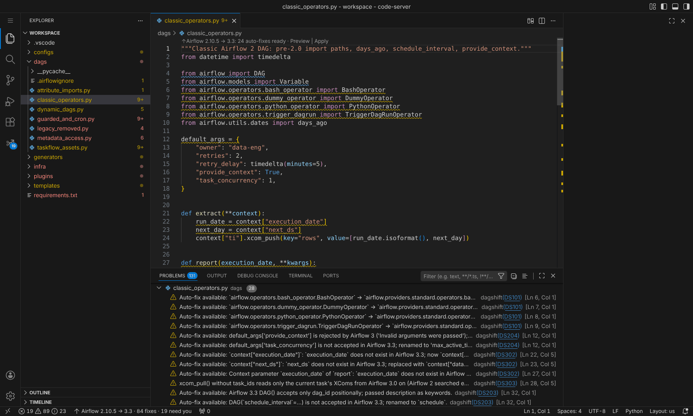
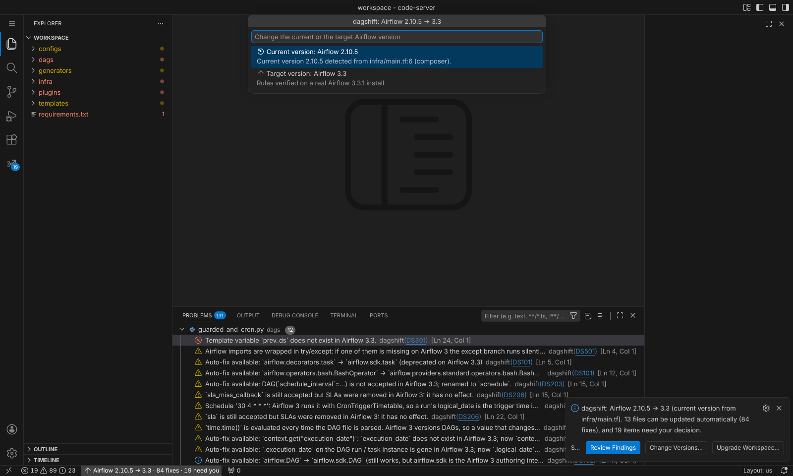
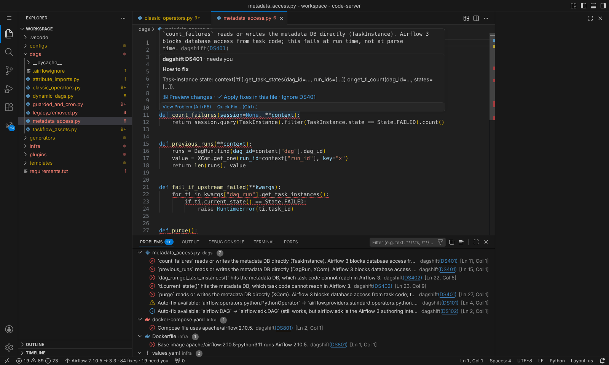
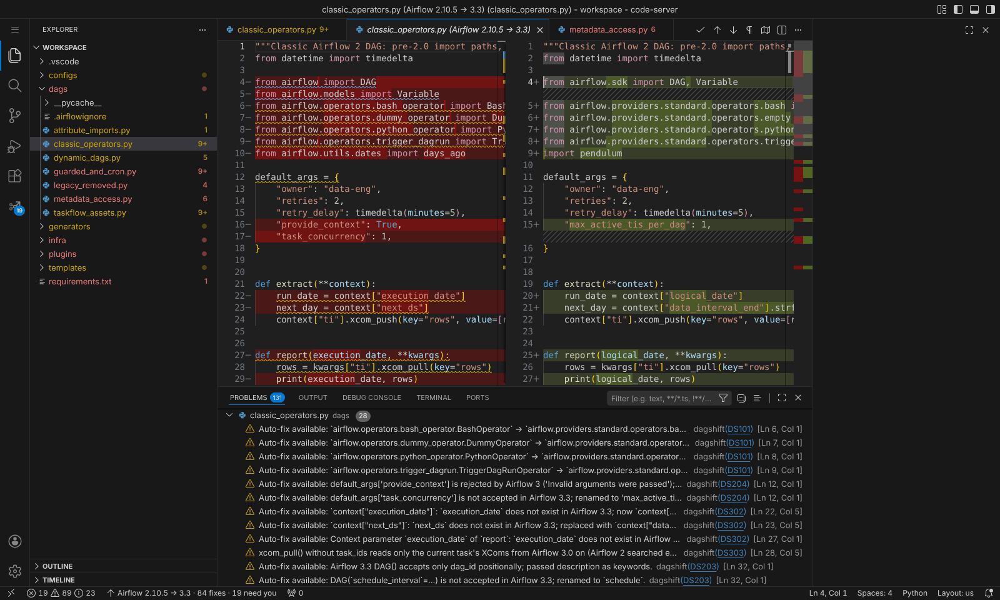
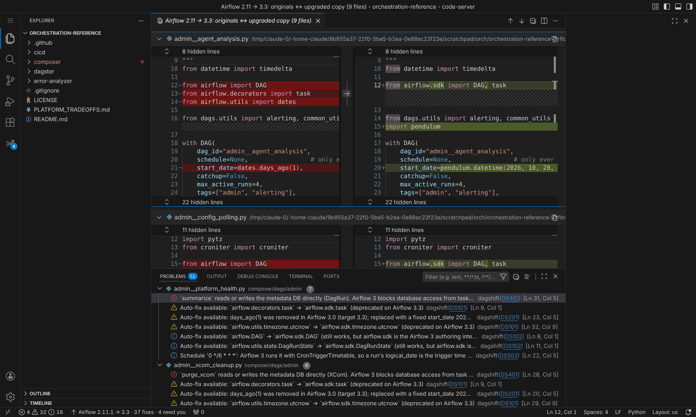

<p align="center">
  
</p>

<h1 align="center">dagshift</h1>

<p align="center">
  <strong>Upgrade Apache Airflow DAGs to any newer version, right inside VS Code.</strong><br>
  2.x → 2.y &nbsp;·&nbsp; 2 → 3 &nbsp;·&nbsp; 3.x → 3.y &nbsp;·&nbsp; a diff before anything is written
</p>

<p align="center">
  <a href="https://marketplace.visualstudio.com/items?itemName=dagshift.dagshift"></a>
  <a href="https://marketplace.visualstudio.com/items?itemName=dagshift.dagshift"></a>
  <a href="https://github.com/dagshift/dagshift/actions/workflows/ci.yml"></a>
  <a href="https://dagshift.github.io/dagshift/"></a>
  <a href="LICENSE"></a>
</p>

<p align="center">
  <a href="https://marketplace.visualstudio.com/items?itemName=dagshift.dagshift"><b>Install</b></a> ·
  <a href="https://dagshift.github.io/dagshift/getting-started/"><b>Get started</b></a> ·
  <a href="https://dagshift.github.io/dagshift/"><b>Documentation</b></a> ·
  <a href="https://dagshift.github.io/dagshift/rules/"><b>Rules</b></a> ·
  <a href="editors/vscode/CHANGELOG.md"><b>Changelog</b></a>
</p>

<p align="center">
  
</p>

---

Open a folder of Airflow DAGs and dagshift tells you which Airflow version the project runs today, what has to
change to reach the version you pick, and fixes everything that can be fixed without changing behaviour. What it
cannot fix safely comes with a concrete recipe. Nothing is written until you have seen the diff.

## Quick start

1. **Install** *dagshift: Airflow Upgrade Assistant* from the
   [Marketplace](https://marketplace.visualstudio.com/items?itemName=dagshift.dagshift), or run
   `code --install-extension dagshift.dagshift`.
2. **Open a folder with DAGs.** dagshift sets up its engine once (about 20 seconds, Python 3.10+ needed) and scans.
3. **Check the status bar**, for example `Airflow 2.10.5 → 3.3`, and click it to change either version.
4. **Review** the findings, then run **dagshift: Upgrade Workspace...** to edit in place or write an upgraded copy.
5. **Validate** the result on a real install of the target Airflow.

## What it does

<table>
  <tr>
    <td width="50%" valign="top">
      <h3>Finds the version you run today</h3>
      Reads requirements, constraints URLs, Dockerfiles, compose, Helm, Cloud Composer <code>image_version</code>,
      MWAA and Astro Runtime, or the code itself when nothing is pinned. Infrastructure in a separate Terraform
      repository? Point at it.
    </td>
    <td width="50%" valign="top">
      
    </td>
  </tr>
  <tr>
    <td width="50%" valign="top">
      
    </td>
    <td width="50%" valign="top">
      <h3>Explains what it cannot fix</h3>
      Metadata database access, SubDAGs, Flask plugins and cron semantics show up in the Problems panel with a
      concrete recipe, such as replacing ORM queries with the Task SDK's <code>get_task_states</code>.
    </td>
  </tr>
  <tr>
    <td width="50%" valign="top">
      <h3>Shows every change first</h3>
      Preview one file as a diff, or upgrade the whole workspace through VS Code's refactor preview, where you can
      untick any file. Undo and source control work as usual.
    </td>
    <td width="50%" valign="top">
      
    </td>
  </tr>
  <tr>
    <td width="50%" valign="top">
      
    </td>
    <td width="50%" valign="top">
      <h3>Or leaves your files alone</h3>
      Write an upgraded copy next to the project instead, with an upgrade report inside. Ideal when Airflow 2 and 3
      run side by side during a Cloud Composer cutover.
    </td>
  </tr>
</table>

It then **proves the result**: *Validate DAGs on Target Airflow* loads your DAG folder with Airflow's own DagBag
and reports import errors and deprecation warnings.

## Upgrades it understands

| From → to | What changes |
|---|---|
| **2.x → 2.y** | Deprecated import paths, `schedule_interval` and `concurrency`, `days_ago`, removed context variables, operator arguments |
| **2.x → 3.y** | All of the above, plus moved operators, `airflow.sdk`, Datasets to Assets, metadata DB access, cron timetable semantics, schedule and catchup defaults, plugins, SLAs |
| **3.x → 3.y** | What changed inside Airflow 3, such as `airflow.datasets` removed in 3.2 and exceptions moving to `airflow.sdk.exceptions` |

Targets from **2.7 to 3.3**, each measured on a real install (2.7.3, 2.8.4, 2.9.3, 2.10.5, 2.11.0, 3.0.6, 3.1.8,
3.2.2, 3.3.1). Works on plain DAG files, TaskFlow, dynamic generators, custom operators and plugins,
Jinja-templated DAG factories, dag-factory and homegrown YAML/JSON pipelines, and code generators that emit DAGs as
strings.

## Results on real DAGs

The eight Cloud Composer DAGs in
[orchestration-reference](https://github.com/jeremydegardeyn/orchestration-reference), rendered and parsed with
Airflow 3.3.1:

| | DAGs that load | Import errors |
|---|:---:|:---:|
| Original | 0 / 8 | 8 |
| After `ruff --select AIR3 --fix --unsafe-fixes` | 0 / 8 | 8, then 4 once `days_ago` is fixed by hand |
| **After dagshift** | **8 / 8** | **0** |

Airflow 2.11's own 62 example DAG files, loaded on Airflow 3.3.1: 40 load with 14 errors and 152 deprecation
warnings before, 66 load with 6 errors (all reported as needing you) and **0 warnings** after. More in
[How it works](https://dagshift.github.io/dagshift/how-it-works/#results).

## How it stays correct

- **Measured, not typed.** Every supported Airflow release is installed and probed: which legacy paths still
  import, which are deprecated or removed, and which replacement is the *same object*. 860 paths across 9 targets
  ship inside the extension.
- **Semantics first.** A rewrite happens only when the new code means the same thing. `days_ago(2)` becomes the
  date it returned on the day you upgrade; `{{ prev_ds }}` has no equivalent, so it is reported, not rewritten.
- **Proven.** The test suite loads upgraded DAGs on real Airflow 2 and 3 installs.
- **Deterministic and idempotent.** Same input, same output; upgrading upgraded code changes nothing.

| | Ruff `AIR3xx` | LLM agent skills | dagshift |
|---|---|---|---|
| `days_ago`, `provide_context`, `schedule_interval`, removed context variables | flags some, fixes few | asks the model | fixed |
| Jinja-templated DAG files (`` in code) | cannot parse | best effort | parsed and fixed |
| Airflow templates inside strings and YAML | no | best effort | fixed |
| Metadata DB access | no | flags | flagged with a Task SDK recipe |
| Behaviour changes (cron, catchup, default schedule) | no | flags | fixed or flagged, configurable |
| Proves the result loads on the target | no | no | yes |

## Privacy

Everything runs on your machine. The extension sends nothing anywhere; the only network access is the one-time
`pip install` of its engine's single dependency (`libcst`) from your configured package index.

## Repository layout

| Path | What it is |
|---|---|
| [`editors/vscode/`](editors/vscode) | The VS Code extension (TypeScript) |
| [`src/dagshift/`](src/dagshift) | The upgrade engine the extension runs locally and bundles as a wheel |
| [`docs/`](docs) | The [documentation site](https://dagshift.github.io/dagshift/), built with [Zensical](https://zensical.org) |
| [`tools/`](tools) | Knowledge-base builder and docs generators ([details](tools/README.md)) |
| [`tests/`](tests) | Engine tests, including runs against real Airflow installs |

<details>
<summary><b>Build from source</b></summary>

```bash
# engine tests
pip install -e ".[dev]"
pytest

# extension: test and package (bundles the engine wheel into the .vsix)
cd editors/vscode
npm ci
npm run typecheck
npm test
PYTHON="$(which python)" npm run package

# documentation site
pip install "zensical<0.1"
python tools/docs_assets.py
zensical serve
```

Releases are described in [PUBLISHING.md](PUBLISHING.md).
</details>

## License

[Apache-2.0](LICENSE)
