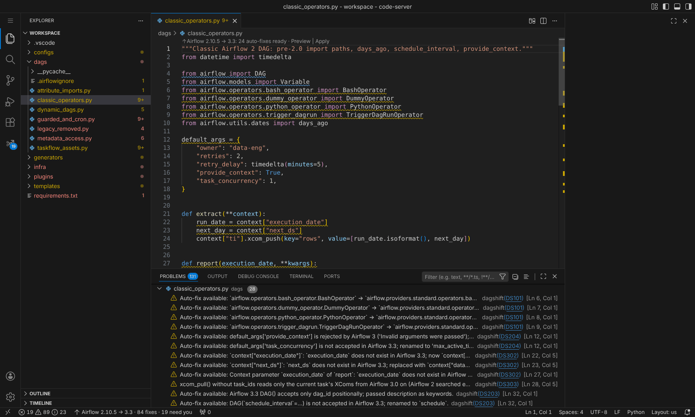
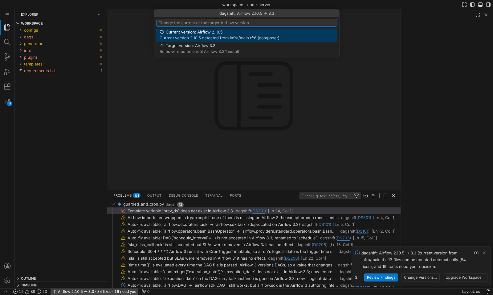
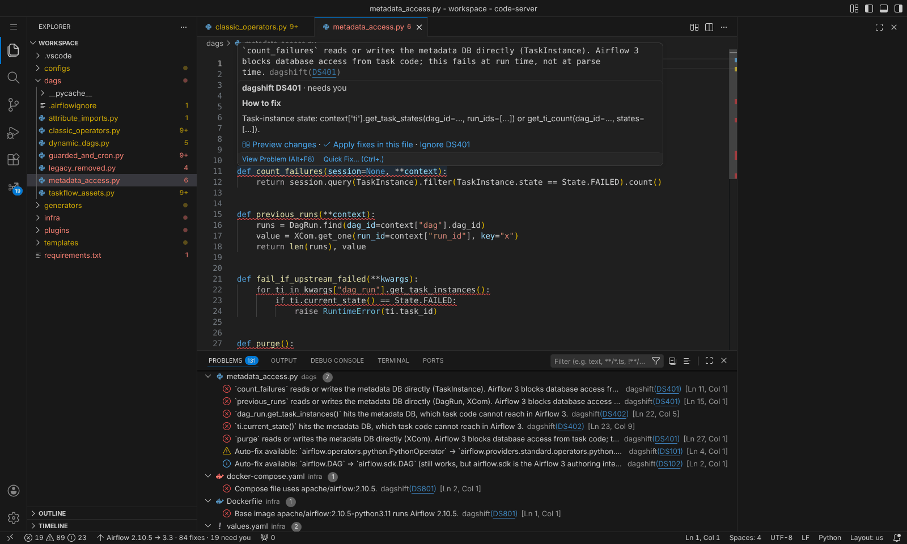
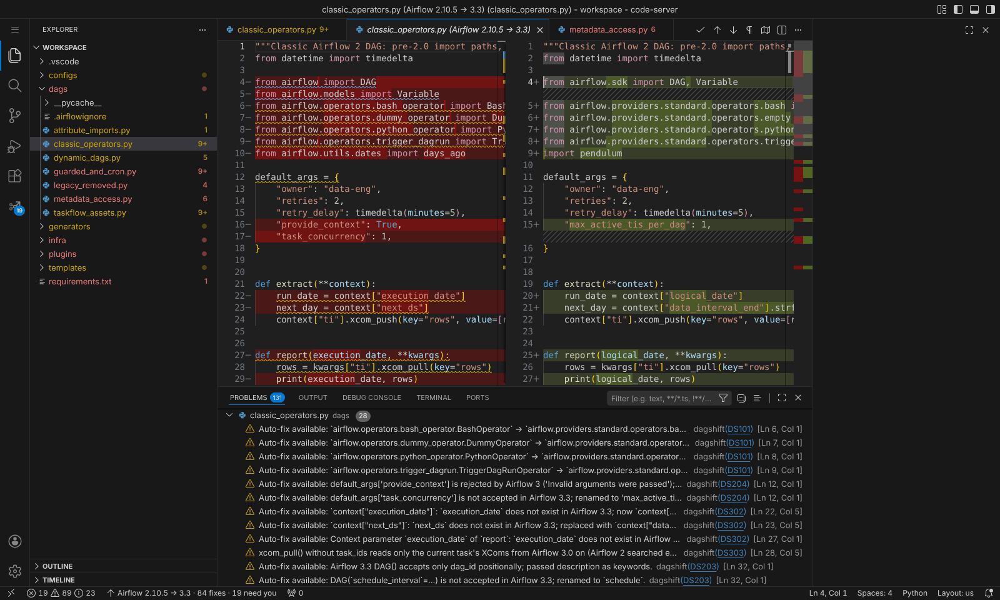
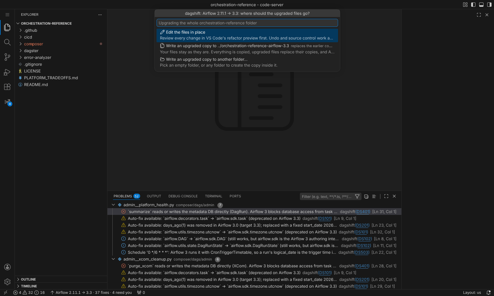
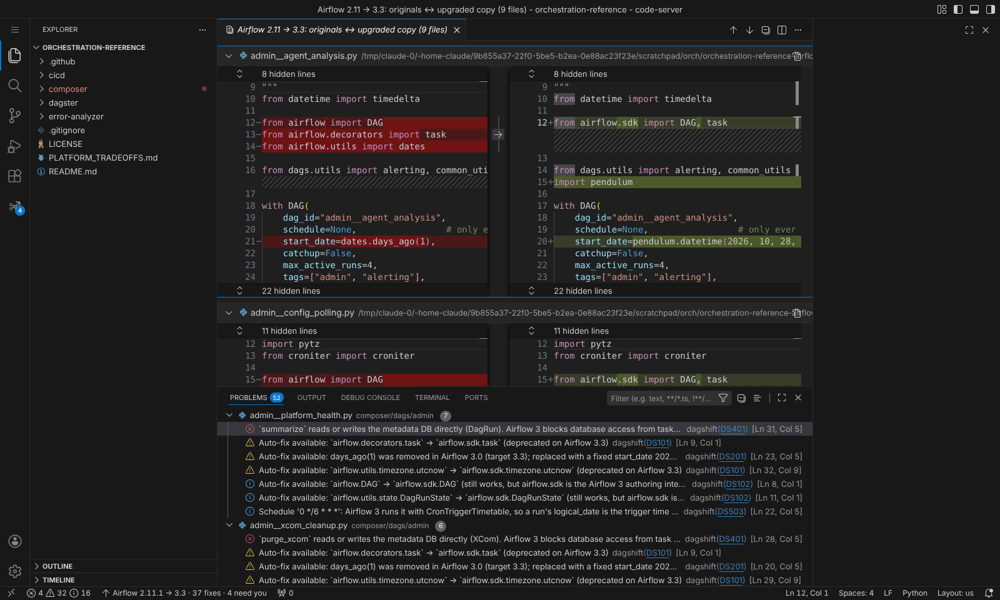
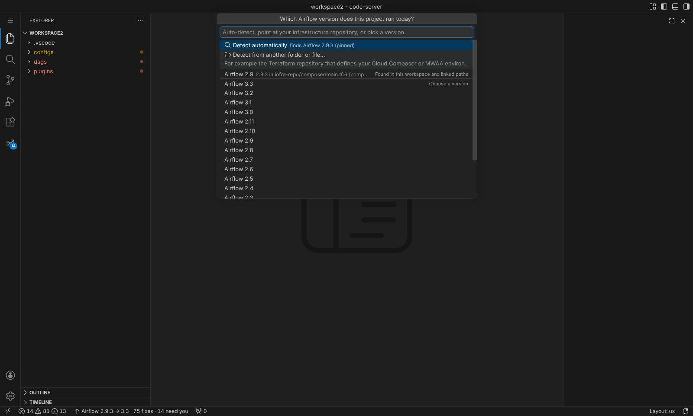

# dagshift: Airflow Upgrade Assistant

Open a folder with Airflow DAGs and dagshift tells you which Airflow version the project runs today, what has to
change to reach the version you pick, and fixes everything that can be fixed safely. Nothing is written until you
have seen the diff.



## What it does

- **Detects the current version** from requirements, constraints URLs, Dockerfiles, compose, Helm values,
  Cloud Composer `image_version`, MWAA and Astro Runtime, or from the code when nothing is pinned.
- **Lets you choose both versions.** The status bar shows `Airflow 2.10.5 → 3.3`; click it to change the current
  version (detect, point at another folder such as your Terraform repository, or pick from a list) or the target
  (2.7 to 3.3).

  
- **Scans automatically** when a folder with Airflow code opens: findings land in the Problems panel and the
  *Airflow Upgrade* view, with a CodeLens at the top of every file that can be updated.
- **Explains what it cannot fix.** Hover a red item for a concrete recipe (for example, replacing ORM queries with
  the Task SDK's `get_task_states`).

  
- **Previews before writing.** One file opens as a diff before anything changes.

  
- **Edits in place or writes a separate copy, your choice.** *Upgrade Workspace* (or *Upgrade Folder* on any
  folder in the Explorer) asks where the upgraded files should go:
  - **Edit the files in place**: every change goes through VS Code's refactor preview, where you can untick any
    file. Undo and source control work as usual.
  - **Write an upgraded copy** next to the project (`../my-dags-airflow-3.3` by default) or to a folder you pick.
    Your files stay untouched, which suits platforms such as Cloud Composer where Airflow 2 and 3 run side by
    side during cutover. *Compare Changes* opens every changed file in one diff view, and the copy includes
    `AIRFLOW_UPGRADE_REPORT.md` with what still needs you.

  
  
- **Proves the result.** *Validate DAGs on Target Airflow* loads your DAG folder with Airflow's own DagBag in a
  Python environment you choose and reports import errors and deprecation warnings.

## Upgrades it understands

| From → to | What changes |
|---|---|
| 2.x → 2.y | deprecated import paths, `schedule_interval`, `days_ago`, removed context variables, operator arguments |
| 2.x → 3.y | all of the above plus moved operators, `airflow.sdk`, Datasets → Assets, metadata DB access, cron timetable semantics, schedule and catchup defaults, plugins, SLAs |
| 3.x → 3.y | what changed inside Airflow 3 (for example `airflow.datasets` removed in 3.2, exceptions moving to `airflow.sdk.exceptions`) |

Every rule is checked against a real install of each target (2.7.3, 2.8.4, 2.9.3, 2.10.5, 2.11.0, 3.0.6, 3.1.8,
3.2.2, 3.3.1). It works on plain DAG files, TaskFlow, dynamic DAG generators, custom operators and plugins,
Jinja-templated DAG factories, dag-factory and homegrown YAML/JSON configs, and code generators that emit DAGs as
strings.

## Requirements

Python 3.10 or newer on the machine. On first use the extension creates its own environment in VS Code's
storage and installs its bundled engine there (one time, about 20 seconds). To use your own install instead, set
`dagshift.interpreter` to a Python that has `dagshift` installed.

## Infrastructure in another repository

Large teams often keep the Composer or MWAA definition in a Terraform repository and the DAGs in another. Click the
status bar, choose *Current version → Detect from another folder or file...* and select that repository (or the
`.tfvars` file). It is saved in `dagshift.sourcePaths`. You can also just pick the version.



For the CLI and CI, keep both versions in the repository:

```toml
# pyproject.toml
[tool.dagshift]
source = "2.10"
target = "3.3"
```

## Settings

| Setting | Default | |
|---|---|---|
| `dagshift.target` | `3.3` | Version to upgrade to |
| `dagshift.sourceVersion` | `auto` | Version the project runs today (`auto` detects it) |
| `dagshift.sourcePaths` | `[]` | Extra files or folders to detect the current version from |
| `dagshift.upgrade.output` | `ask` | `inPlace`, `folder` (write a copy), or ask each time |
| `dagshift.upgrade.outputFolder` | `${folderName}-airflow-${target}` | Where a copy goes; relative paths sit next to the upgraded folder |
| `dagshift.scanOnOpen` | `true` | Scan when a folder with Airflow code opens |
| `dagshift.modernize` | `true` | Also update code that is deprecated (not yet removed) on the target |
| `dagshift.keepCronDataIntervals` | `false` | Keep Airflow 2 `ds`/`logical_date` meaning for cron schedules on Airflow 3 |
| `dagshift.validate.airflowPython` | | Python with the target Airflow installed, for validation |

Fix on save: `"editor.codeActionsOnSave": { "source.fixAll.dagshift": "explicit" }`.

## Privacy

Everything runs locally. The extension sends nothing anywhere; the only network access is the one-time
`pip install` of its engine's dependency (`libcst`) from your configured package index.

## Command line

The same engine is on PyPI: `pip install dagshift`, then `dagshift detect`, `dagshift check`, `dagshift migrate`
and `dagshift validate`. See the [project README](https://github.com/dagshift/dagshift).
